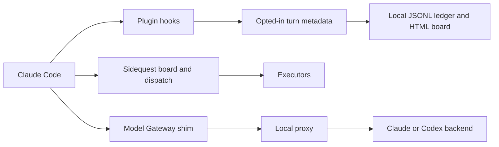

## Maintainer overview

Eigenwise Toolshed is a marketplace of independent Claude Code plugins. Each plugin owns its setup, hooks, skills, and local state. The plugins cooperate through small, explicit boundaries rather than importing one another's implementation.

- Quartermaster owns the cross-plugin setup plan for new and existing projects, updates Toolshed plugins, and checks workspace health.
- Codebase Mapper and Live Rules add project context without requiring the other plugins.
- Observability records opted-in turn metadata in a local JSONL ledger and rebuilds a self-contained HTML board. Nothing leaves the machine.
- Sidequest owns tickets, stories, routing, dispatch, and executor evidence.
- Model Gateway owns the optional model-proxy boundary. Claude models can keep their normal API path.

Sidequest's PreToolUse guards run inside one hooks module (`plugins/sidequest/hooks/guards/register.ts`) on `tool.call`, so a tool call no longer starts a node process per guard. The module learns who is calling from `dispatch-snapshot.json`, a per-project file the board rewrites after every dispatch write. Only an Agent spawn, or a call the executor admission guard could refuse, runs that guard's Node decision as one `$.process.run`. An Agent spawn fails closed when that decision can't run; every other guard fails open. Two command hooks remain because they need fields `tool.call` doesn't carry and they write the store: bind-runtime-identity and guard-worktree-isolation.

See [modular Toolshed architecture](./modular-architecture/) for the registry and routing boundaries. User-facing installation and daily use belong in the [plugin guides](../getting-started/), not here.
