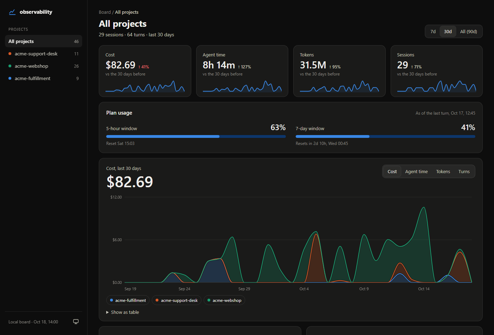

Observability is a local Claude Code hooks module. It records one metadata row per completed main-thread turn, including aborted, refused, and failed turns. Recording is off until you enable it in each project.

## Commands

- `/observability:track on` enables recording for the current project.
- `/observability:track off` stops future recording. Existing history stays on disk.
- `/observability:track status` reports whether the current project records turns.
- `/observability:board` rebuilds and opens the local board.

Installing the plugin does not opt any project in.

## What the board shows

The board shows cost, agent time, tokens, sessions, quota usage, project activity, model mix, tool calls and failures, ticket totals, session outcomes, and activity streaks. Filter by project, period, or session name. Cost uses the engine's own /cost figure, with per-turn differences from its session total. There are no price tables or estimates. Agent time sums turn durations; it can exceed elapsed wall time when sessions overlap.

## Local data and privacy

The Claude config directory is `CLAUDE_CONFIG_DIR` when set, otherwise `~/.claude` (`%USERPROFILE%\.claude` on Windows). Ledgers live at `<claude config dir>/observability/ledger/<project-slug>.jsonl`. The slug is the project root's basename (characters outside letters, digits, underscore, dot, and hyphen replaced by underscores) followed by a six-character hash of the full path, so two projects with the same folder name keep separate ledgers. The generated board is `<claude config dir>/observability/board.html`.

Metadata includes project names, session identifiers and titles (or the first prompt line, up to 60 characters), model names, token counts, exact engine cost, timing, tool names and counts, agent types, context usage, quota usage, compaction, outcomes, and a ticket identifier when present. Full prompts, responses, code, tool inputs and results, credentials, and environment values are not recorded. Session names can contain sensitive text, so treat the ledger and board as private files.

Nothing leaves the machine. The board is a self-contained local HTML file with no server, network requests, or remote sinks. Turning tracking off keeps existing files; deleting history is a separate manual file deletion.
